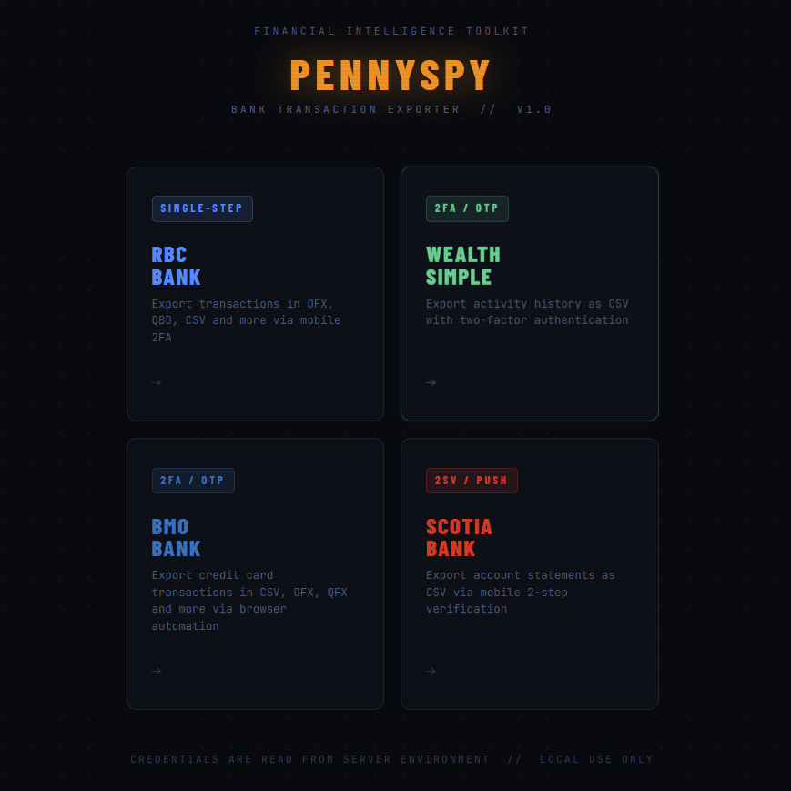

# PennySpy


[](https://opensource.org/licenses/MIT)

Canadian bank transaction scraper with API endpoints for automated retrieval of transaction history. Can be self-hosted on your computer directly via a Docker image or accessed directly through Python for seamless integration.

Running locally gives you full control over when and how data is retrieved. You can trigger requests on demand, making it fully compatible with modern banking security flows such as one-time passwords (OTP) and push-based two-factor authentication (2FA).
# Supported banks
- Wealthsimple
- National Bank (NBC)

RBC, Scotiabank and BMO are decommissioned and no longer supported.

The API provides a landing page that allows users to easily download their transaction history.


# Installation
## Docker (Recommended)
Pennyspy api is available as a Docker image ready to be run in your own custom environment.
### Launch container using Docker Compose
You can use the `docker-compose.yml` file included in the repository to run the latest stable version of the API.
Create the data directory first, so it belongs to you rather than to root, then start the container:
```shell
mkdir -p pennyspy-data
docker compose up --detach
```
Then open http://localhost:5056 and add your bank logins on the **Logins** page (see
[Bank logins](#bank-logins)).

The image runs as uid/gid **1000** (set again by `user: "1000:1000"` in `docker-compose.yml`).
`./pennyspy-data` must be owned by the same ids, or logs, exports and saved logins cannot be
written. Check with `ls -ln` and fix with `sudo chown -R 1000:1000 pennyspy-data`. If your user
has another uid, change the `user:` line to match it and make sure the directory is owned by that uid.

### Launch container using docker command
It is possible, alternatively, to use docker using this command.
```shell
docker run --restart=unless-stopped -d -p 5056:5056 -p 7900:7900 --shm-size=2g --user 1000:1000 -v YOUR/PATH/TO/DATA:/app/data --name pennyspy moqba/pennyspy:latest
```
`YOUR/PATH/TO/DATA` must be owned by uid 1000.

### Watch the browser live
The image runs Chrome **visibly** on a virtual display and ships a built-in noVNC viewer, so you can
watch a scrape happen in real time — handy for debugging logins and 2FA. Once the container is
running, open **http://localhost:7900** in your browser (default password: `secret`).

The browser is visible by default. To run it headless instead (no live view, lower resource use),
set `PENNYSPY_HEADLESS=true` in your environment / `docker-compose.yml`.

## Python package
Pennyspy can be installed a python package :  
`pip install git+https://github.com/moqba/PennySpy`  
This allows you to run the scraper directly in Python.

Or start the [API service](#API) after installing the Python package :
```shell
pennyspy_api
```


# API
The main API service supports all banks.
It runs on the port 5056 by default, user can modify the port by setting `PENNYSPY_PORT` env variable.
The Docker image starts the API service automatically.
See the bank’s setup page for API call details.

## Jobs
Signing in, checking a code and exporting can each keep a browser busy for minutes, so they run
as background jobs. Starting one answers `202` at once with the job; follow it until its `state`
is `done` or `failed`, then fetch an export's files.

| Method & path                     | What it does |
|-----------------------------------|--------------|
| `POST /<bank>/login/jobs`         | Start signing in (same body as `/<bank>/login`). The finished job has `session_id` and `auth: {status, message}` |
| `POST /<bank>/verify/jobs`        | Check the code: `{session_id, otp_code}`. The finished job has `auth` |
| `POST /<bank>/export`             | Start an export (same body as `/<bank>/scrape`). The finished job lists `files: [{index, filename, size, url}]` |
| `GET /jobs/{job_id}`              | The job now: `state` (`queued`, `running`, `done`, `failed`), `stage`, `detail` (the browser's latest step), `error` |
| `GET /jobs/{job_id}/events`       | The same, as server-sent events each time it changes; the stream ends when the job finishes |
| `GET /exports/{job_id}/file?index=0` | One file of a finished export, as a normal download (`409` while it is still running) |

Jobs run one at a time, in order. Finished jobs are forgotten after an hour; the exported files
stay in the data directory for 7 days. The blocking `/<bank>/login`, `/<bank>/verify` and
`/<bank>/scrape` still work: they run the same jobs and wait for them.

Screenshots captured during scraper errors are written to the data directory by default. With the included Docker Compose file, they appear under `./pennyspy-data/screenshots`. Override `PENNYSPY_SCREENSHOT_DIR` if you want a different location.

Set `PENNYSPY_FAILURE_HTML_DIR` to also save the current browser page HTML when a scraper failure screenshot is captured. With Docker Compose, use `/app/data/failure-html` to make those files appear under `./pennyspy-data/failure-html`. Captured HTML may contain sensitive bank page content, so this is disabled unless the environment variable is set.


# Bank logins
Logins are managed in the web UI, on the **Logins** page (`/app/credentials.html`, linked from
the home page):

- **Add** a login with a bank, a label of your choice (for example "Personal" or "Joint"), a
  username and a password. You can save several logins for the same bank.
- Once saved, a login is **never shown again**. The list shows its label and a partly hidden
  username (`jo•••@gmail.com`, `12•••89`) so you can tell them apart. You can only **edit** or
  **remove** it. When editing, leave the username or password blank to keep the saved value.
- Each bank page has a **Login** dropdown to pick which saved login to sign in with. API callers
  pass the chosen login's id as `credential_id` to `/<bank>/login`, so a password never travels
  in a scrape request.

### How they are stored
Usernames and passwords are encrypted with [Fernet](https://cryptography.io/en/latest/fernet/)
(AES-128-CBC with an HMAC-SHA256 signature) before they are written to `credentials.json` in
the data directory (`/app/data`, which is `./pennyspy-data` with Docker Compose). Only the bank,
the label and the timestamps are stored in plain text. The key is generated automatically the
first time a login is saved and kept in `secret.key` next to it, readable by its owner only.

- **Back up `secret.key` together with `credentials.json`.** Without the key, the logins cannot
  be decrypted and must be added again. If `credentials.json` holds logins but `secret.key` is
  missing, PennySpy refuses to make a new key and reports the problem instead.
- This protects logins from leaking through API responses, the web UI, the logs, or a copy of
  `credentials.json` on its own. It does not protect against someone who can read the whole data
  directory, because the key sits beside the data.
- The API has no authentication of its own. Anyone who can reach it can start a scrape with a
  saved login, though they can never read the login. Keep it on your local network.
- `PENNYSPY_CREDENTIALS_DIR` moves both files to another directory.

### Which login is used
`/<bank>/login` picks the login in this order:
1. the saved login named by `credential_id`;
2. the bank's only saved login, when exactly one is saved;
3. the legacy env variables for that bank (`PENNYSPY_WSU`/`PENNYSPY_WSP`), so existing setups
   keep working. NBC has none.

When several logins are saved for the bank and no `credential_id` is sent, the call fails with a
400 that asks for one. Using the scrapers directly from Python works as before: pass
`credentials=LoginCredentials(...)` to `start_auth`, or leave it out to use the env variables.

### Logins API
| Method & path               | Body                                                                     | Returns |
|-----------------------------|--------------------------------------------------------------------------|---------|
| `GET /credentials?bank=ws`  | —                                                                        | `[{id, bank, label, username_hint, created_at, updated_at}]`; `bank` is optional (`nbc`, `ws`) |
| `POST /credentials`         | `{bank, label, username, password}`                                      | the new login's metadata (201) |
| `PUT /credentials/{id}`     | `{label?, username?, password?}`; blank or missing keeps the saved value | the updated metadata |
| `DELETE /credentials/{id}`  | —                                                                        | 204 |

No endpoint returns a username or a password.

# Setup
For Wealthsimple setup and API details, consult the [Wealthsimple setup guide](pennyspy/scrapers/wealthsimple/setup.md).
For National Bank, consult the [NBC setup guide](pennyspy/scrapers/nbc/setup.md).

